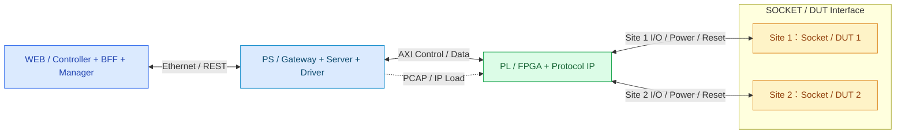
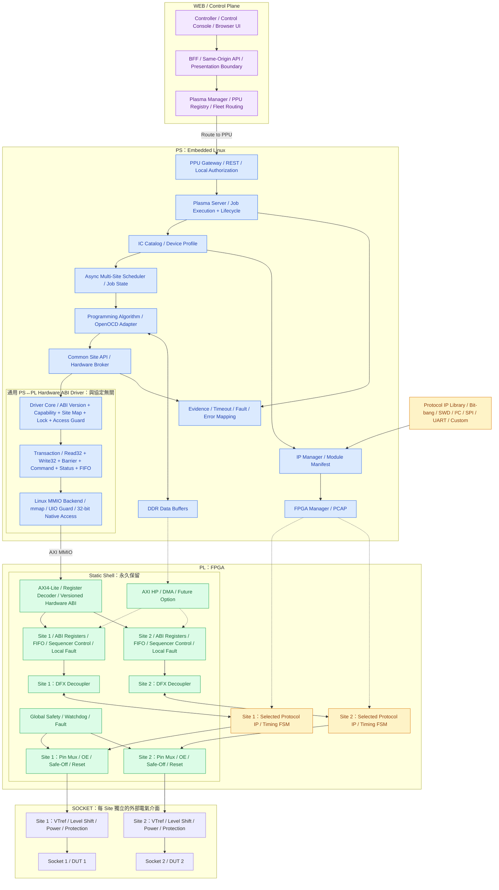

# PLASMA 通用燒錄器 — vNext 系統與 FPGA 架構

> **文件狀態：vNext 目標架構提案（PROPOSED；實作狀態逐項依證據）**  
> **日期：2026-10-22**  
> **目前設計範圍：2 Site；未來擴充目標：8 Site**  
> **使用方式：** 本檔採用 HackMD 相容的 Markdown 與 Mermaid，可直接匯入 HackMD。  
> **注意：** 本文件不代表 DFX、DMA、各種專用 Protocol IP、Site 電氣隔離或八通道功能已完成實作／硬體驗證。2026-10-22 已有 PR #1111 的 2 Site Host-only SIM 證據，但不是實體 Z2／DUT 驗證。

[toc]

## 1. 架構原則與範圍

PLASMA 是由上位機（Control Station）、Zynq PS（Embedded Linux）、Zynq PL（FPGA）及多個獨立燒錄 Site 組成的通用 IC 燒錄系統。

本版架構採用下列設計原則：

1. **Protocol-neutral Driver：** PS↔PL Hardware ABI Driver 負責受控暫存器、Command、資料及狀態存取；不包含 IC-specific 協定語意。Web Controller、BFF、Plasma Manager、PPU Gateway、Plasma Server 與 PS Driver 各自具有獨立的責任邊界。
2. **Protocol Engine 位於 PL：** 時序敏感的 Bit-bang、SWD、I²C、SPI、UART 由 FPGA IP／Sequencer 執行，PS 不逐一產生每個訊號邊緣。
3. **Static Shell + Loadable IP：** 將穩定的 ABI、管理、安全及 I/O 功能保留在 Static Shell；依料號所需能力載入已編譯的 Protocol IP。動態載入（DFX）是尚待驗證的目標功能。
4. **Site 獨立：** 每個 Site 有獨立的命令狀態、緩衝、時序、故障與電氣保護；共用資源故障另由 PPU Global Fault 管理。
5. **Control/Data Plane 分離：** AXI4-Lite 負責控制；較高吞吐量時另評估 FIFO、AXI4／HP／DMA 資料路徑。
6. **容量以證據決定：** 現階段只規劃及驗證 2 Site；擴充至 8 Site 取決於 RTL、Vivado 資源／時序、功耗、I/O、電氣與實測吞吐量。

### 舊資料處理政策

過去文件中的「第一代固定 Universal Bitstream 為唯一方案」、「所有 Site 必須永遠使用相同 IC」等歷史**架構假設**，於本 vNext 提案中標示為 **SUPERSEDED / HISTORICAL**，不再作為新架構設計的強制前提。若相關規則仍存在執行中的程式碼，需先透過另行核准的實作與驗證完成遷移，**不可因文件更新就宣稱現有系統已改變**。既有真實 RTL／CI／HIL 證據應保留，且不得被改寫成新架構的 PASS。

## 2. 第一層：整體架構總覽（WEB / PS / PL / SOCKET）

這張圖只保留**四個主要層次**及兩個 Site 的訊號流，並在框內標示各層核心職能；Driver、IP、管理服務及暫存器的完整連線在第二層展開。

**四層責任：** WEB 的 Controller／BFF／Manager 負責操作、展示、管理與機台路由，不直接執行燒錄；PS 的 Gateway／Server／Driver 負責授權、選料、排程、演算法與 PS↔PL 存取；PL 負責協定訊號及精確時序；SOCKET 層包含電氣保護、電源／Reset 與實際 DUT。這是**邏輯分層**，WEB 的 BFF／Manager 是服務端元件，並非全部都在瀏覽器內執行。

## 3. 第二層：內部詳細架構（WEB Controller／BFF／Manager、PS Driver、PL IP、Site）

這張圖展開第一層的所有元件：**WEB Controller → BFF → Plasma Manager → PPU Gateway → Plasma Server → PS Generic Hardware ABI Driver → PL Static Shell → Site Protocol IP → SOCKET**。為可讀性，兩個 Site 用相同結構展示；各個 API、Driver 與 FPGA IP 的詳細契約另以後面的表格定義。這是目標分層，不代表所有方塊都已落地。

**圖例：** 紫色＝WEB／控制平面；藍色＝PS 軟體（含 Gateway／Server／Driver）；綠色＝FPGA Static Shell；黃色＝Protocol IP Library 或當前載入的 IP。虛線＝規劃中的 DFX／DMA 路徑。

### 3.1 WEB 的 Controller／BFF／Manager 分工

| 元件 | 責任 | 不應負責 |
| --- | --- | --- |
| **Controller／Control Console** | 操作畫面、選料號／Site、下達 Job 要求、顯示狀態與證據 | 直接映射 PL 暫存器或操作實體 FPGA |
| **BFF（Backend for Frontend）** | 同源 API、介面資料整形、前端認證／授權上下文轉送、請求限制、隱藏 Manager 拓撲 | Job 執行、燒錄演算法、直接管理 PPU Hardware |
| **Plasma Manager** | PPU Registry、Alias→PPU 路由、機隊狀態監看、Managed Mode 管理 | FPGA Timing、PS↔PL MMIO、代替 PPU 執行 Job |

**控制面呼叫路徑：** Browser Controller → BFF → Plasma Manager → 目標 PPU Gateway → Plasma Server；實際燒錄工作由 PPU 本地 Server／PS 執行。這保留先前的 Controller／BFF／Manager／Gateway／Server 責任區分，沒有將所有 REST 都放進同一個 PS「Gateway」方塊。

### 3.2 PS 的完整軟體與通用 Driver 分層

| 層次 | PS 元件 | 職責／介面 |
| --- | --- | --- |
| 接入與授權 | **PPU Gateway** | 北向 REST、PPU 本地授權、攔截未授權 Job；不等於 WEB BFF |
| 執行服務 | **Plasma Server** | Job Lifecycle、Cancel、Retry Policy、狀態、日誌、錯誤與證據收集 |
| 裝置模型 | **IC Catalog + Device Profile** | 解析 Exact Part、Pin Profile、VTref、Protocol、Algorithm 與安全限制 |
| 排程 | **Async Multi-Site Scheduler** | Site 資源分配、鎖定、相互獨立的 Job／Timeout／Completion |
| 協定／演算法 | **Programming Algorithm + OpenOCD Adapter** | IC 的 Erase／Program／Verify 流程、SWD／SPI／I²C／UART 高階交易；不以 Linux User Space 逐邊緣產生高頻波形 |
| 共用抽象 | **Common Site API / Hardware Broker** | 以 Site ID、Capability、Transaction 為單位，統一呼叫下層 Driver，不綁定 SWD |
| **Driver Core** | **Generic Hardware ABI Driver** | ABI Version／Build ID／Capability 檢查、Site Map、存取權限與範圍、同步／鎖定、Fault Mapping |
| **Driver Transactions** | **Command / FIFO / Register Interface** | `read32`、`write32`、`barrier`、Command Submit、Status／Completion／Timeout、FIFO 資料交換；高階交易須由對應 PL IP 支援 |
| **Driver Backend** | **Linux MMIO / mmap** | Native aligned 32-bit MMIO、Memory Ordering／Barrier；UIO 或受控 `/dev/mem` 視可用環境選擇；不可混用任意位元組寫入 |
| 配置管理 | **IP Manager + Module Manifest + FPGA Manager** | 載入前驗證映像與目標 Site 相容性、Quiesce、安全狀態、PCAP／DFX；配置與一般 MMIO Transaction 分離 |
| Data／Observability | **DDR Buffer / Diagnostics / Evidence** | 傳輸緩衝、長交易證據、時間與故障紀錄；FIFO／IRQ／DMA 是否需要由量測決定 |

**Driver 的責任邊界：** Driver 是共用的 PS↔PL 存取層，不是 SWD Driver、I²C Driver 或 Bit-bang Driver 的同義詞。Protocol-specific 操作屬於 Algorithm／Protocol Adapter 與 PL Engine；Driver 只提供經 ABI 驗證的命令、資料與狀態傳輸。PS 採 OpenOCD 的協定控制模型時，也必須經由明確的 Adapter／Backend 與權限控管，不能繞過 Site 安全 Gate。

**現況標記：** Linux ARMv7 native 32-bit MMIO、PS↔PL CONTROL／STATUS Echo、部分 SWD Loopback 曾有 Z2 HIL PASS 證據；圖中的雙 Site 完整 FIFO、統一命令 Driver、DFX、選料自動 IP 載入、所有 Protocol Engine 及外部故障隔離仍需分別核對最新程式碼與實測，**不得視為目前均已完成**。

**物理設計原則：** 不應將 Power Cutoff、Pin Output Enable、安全隔離控制放在可能重新配置的 Region 內。單一 Reconfigurable Region 可以載入不同相容 Module；這張圖不表示五種 Protocol IP 同時存在，也不表示任何料號都必須有專屬 Bitstream。

### Static 與 Dynamic 邊界

| Static Shell／共用基礎 | Dynamic／可選 Protocol IP |
| --- | --- |
| 版本化 Hardware ABI、AXI Decoder、Site Registers | SWD Engine |
| Hardware Broker 對應的 Site Controller／Admission | I²C Master |
| DFX Decoupler、Reset、必要 Clock／Data Interface | SPI Master |
| Pin Mux、GPIO Direction、Input Readback、High-Z | UART Engine |
| Local Safety、Watchdog、Fault、必要監測 | Generic Bit-bang Waveform Engine |
| 外部電源安全控制連接與鎖定機制 | 特殊 IC 專用加速邏輯 |

## 4. 選料號後的 Protocol IP 載入流程

1. 使用者選擇 Exact IC 料號；Catalog 解析需要的 Protocol、Programming Algorithm、Pin Profile、電壓與時序限制。
2. IP Manager 查詢 Module Manifest、Capability、版本及目前 Site 已載入的模組。
3. **若模組相容：** 直接進行 Site Ready／電氣安全檢查；不需要每次換 IC 都重新配置 FPGA。
4. **若模組不相容：** 將目標 Site Quiesce 並確認外部 Safe-Off，檢查 Image／Static Shell／Region 相容性，才透過 PCAP 進行 DFX。
5. 重配置後驗證 IP Identity、Hardware ABI、Capability、Reset 狀態及安全 Admission；任何失敗停止後續執行。
6. PS 提交高階命令及資料，由 PL Protocol Engine 執行 Program／Verify，最後回報 Result 與診斷證據。

- **載入的是事先編譯的 Partial Bitstream，非 Verilog 原始碼。** 它必須與 FPGA 器件、Static Shell 及目標 Reconfigurable Partition 相容。
- 同一種 Protocol IP 可服務多種 IC；不同料號通常僅需不同 PS 演算法、Flash Algorithm、Pin Profile、Voltage／Timing 參數。
- DFX 使用 PPU 層級唯一的 Configuration Owner，序列化配置操作。**「Site 1 載入、Site 2 不停止」是未來需要驗證的目標，不是已證實的特性。**
- 任何驗證失敗應停止該 Site 的燒錄 Admission；不能把 FPGA Manager 顯示 operating 視為相容性或外部 DUT 電氣安全的證明。

## 5. Control Plane / Data Plane

| 通道 | 技術 | 功能 | 優先順序 |
| --- | --- | --- | --- |
| Control | AXI4-Lite | 選 Site、Command、Config、Status、Fault | 必要 |
| PIO Data | AXI4-Lite + per-Site FIFO | SWD Transaction、短 SPI transfer、低速 Bit-bang 批次 | 先驗證 |
| High-throughput Data | AXI4／AXI HP + DMA／Stream | 大型 Flash image 及高吞吐量多 Site 操作 | 量測後決定 |
| Completion | Polling，後續可加入 IRQ | 非同步完成、Fault、Timeout | Polling 起步 |
| Configuration | PCAP / DFX | 維護相容的 Site IP | 後續可行性驗證 |

**注意：** AXI4-Lite 本身不支援 Burst；不能將多次 `write32` 包裝成 `burst_write()` 就聲稱硬體具備 AXI Burst。必須以適當 AXI4／HP 路徑配合真實 IP 及 DMA 實作。

Hardware ABI Driver 的 `read32`、`write32`、`barrier` 只是 primitive。對於 timing-critical 協定，PS 提交高階 Transaction；**PL 的 Protocol State Machine 執行時鐘邊緣、turnaround、ACK、clock stretching 等時序**。

## 6. Site 並行、故障隔離與安全

### 6.1 Site 執行契約（目標）

- 每個 Site 有獨立的 Job、Transaction Sequence、Completion、Timeout、Fault 與回應資料；避免跨 Site FIFO、計數器或 Result 污染。
- 每個 Site 的 Clock Divider／Protocol Timing 可依 IC Profile 設定；實際獨立時鐘資源需求要由 RTL 決定，不等於每個 Site 必須有一顆獨立 PLL。
- PS 可以非同步排程多 Site，即使使用短週期 Status Polling 也不必代表 PL 只能序列執行。不能以同時顯示 RUNNING 取代真正的時序重疊與吞吐量證據。
- 單一 Site 的 DUT Fault 預設只停止該 Site；若共享電源、AXI、Broker、配置狀態或系統完整性變得不確定，才升級 PPU Global Fault。
- 不可自動重播是否已對 DUT 生效不明的寫入／Erase／Program Transaction。

### 6.2 三層安全責任

| 層次 | 責任 | 失效情境 |
| --- | --- | --- |
| PPU Global Safety | 共用電源、配置 Owner、AXI／Broker Fault、全域停止 | 共享資源失效時阻止所有新 Job |
| Site-local Safety | Site Timeout、Reset、Power Enable、OE、Pin Mux、Local Fault | 只隔離故障 Site |
| External Hardware Protection | 過電流、反灌電、電平轉換、VTref、Power Cutoff、實體隔離 | FPGA 未配置或異常仍保護 DUT |

**必須實測：** Site 1 短路時，Site 2 的電源是否仍維持規格？僅靠 FPGA Site-local Safety FSM 並不能保證共享供電不被拖垮。

## 7. FPGA IP Module Manifest（建議欄位）

| 欄位 | 用途 |
| --- | --- |
| `module_id` / `module_version` | 模組識別及版本 |
| `protocol` / `capabilities` | SWD／I²C／SPI／UART／Bit-bang 與具體支援能力 |
| `fpga_part` | 目標器件（如 XC7Z020 或 XC7Z010） |
| `static_shell_id` / `static_shell_hash` | 靜態設計相容性 |
| `target_region` / `site_id` | 實體配置目標；不可臆測 Partial Bitstream 跨 Region 可互換 |
| `hardware_abi_version` | Driver／Site ABI 相容性 |
| `bitstream_sha256` | 檔案完整性（不等於執行安全認證） |
| `resource_report` / `timing_report` | LUT／FF／BRAM／DSP、時脈與 Timing Closure |
| `pin_profile_constraints` | Pin Mux、Open-drain、電壓與電氣限制 |

## 8. 2 Site → 8 Site 擴充 Roadmap

| 元件 | 現階段：2 Site | 未來：8 Site |
| --- | --- | --- |
| PS 與 PPU Gateway | 共用一組 | 共用，負責更多非同步 Job |
| Universal Hardware ABI Driver | 共用 | 維持同一抽象，擴展可發現的 Site |
| Site Controller | 2 個邏輯實例 | 8 個邏輯實例（需實際建置） |
| Protocol IP | 按 Site 需求配置 | 依 LUT／BRAM／Timing 決定獨立或共享 |
| DFX Region | 2 區目標，待可行性驗證 | 不能預先保證 8 區可放入 XC7Z010 |
| Data Path | Command + FIFO 優先 | 依吞吐量及 CPU Profile 決定 DMA／HP |
| 電氣安全 | 2 組獨立保護 | 8 組個別保護與共享資源保護 |
| 實機驗證 | 等待雙 Site HIL | 必須另做八 Site 功能／效能／故障驗證 |

### 建議的效能量測

1. 每個 Site 的 `command_latency_us`、`transaction_time_us`、`completed_bytes_per_s`。
2. PPU 總吞吐量、PS CPU 使用率、MMIO requests/s、FIFO 深度與 Occupancy。
3. Site 1／2 同時工作的 P50、P95、P99；比較單站與雙站總耗時。
4. 注入某 Site Timeout／NACK／SWD WAIT／Power Fault 後，檢查其他 Site 不中斷且資料正確。
5. Vivado 的 LUT／FF／BRAM／DSP 使用量、Fmax／Timing Slack、功耗與 DFX Floorplan 可行性。

## 9. 未決設計問題（Open Decisions）

| 編號 | 問題 | 判定需要的證據 |
| --- | --- | --- |
| D-01 | 兩個獨立 DFX Region 是否可在 XC7Z020／XC7Z010 完成佈局與 Timing？ | Vivado Floorplan、Synthesis、P&R、Partial Bitstream |
| D-02 | Site 1 IP 換載能否讓 Site 2 繼續正常燒錄？ | Decoupler、Power、ABI、Config Owner、真實 HIL |
| D-03 | PIO FIFO 何時不足？ | 雙站及未來多站 Throughput／CPU／FIFO 實測 |
| D-04 | 何時需要 IRQ／DMA？ | 量測後的延遲、CPU 開銷與產品需求 |
| D-05 | Site 間共享 FPGA Engine 或各自獨立？ | LUT／BRAM 成本與最壞情況公平性／吞吐量 |
| D-06 | 不同 IC／Protocol 是否允許同一批次混用？ | Job／Batch 模型、機台商業需求及隔離規格的正式決策 |
| D-07 | 外部 Power、VTref、OE 如何在 DFX 期間維持 Fail-safe？ | 電路設計、電氣測量及 Fault Injection |

## 10. 驗證與授權邊界

**目前僅是一份新的目標架構文件。** 下列能力不能因文件或 GitHub-hosted Simulation 成功而被視為已完成：

- 兩個 Site 的真實 Z2 PS↔PL 閉環及外部 DUT 燒錄。
- I²C／SPI／UART／Bit-bang 專用 Protocol IP 的實體訊號驗證。
- DFX Partial Bitstream 產出、熱替換、安全隔離與 Rollback。
- AXI HP／DMA、IRQ、八 Site 並行吞吐量。
- 獨立電源保護、電平轉換及短路故障測試。

後續開發仍需獨立的實作與測試 Gate。沒有授權就不操作 SWPC、Z2、DUT、外部燒錄設備或硬體配置；也不會因本文件產生部署或 PR 合併權限。

## 11. 備註：架構相關工作全展開（WBS）與狀態追蹤

> **狀態快照：2026-10-22；範圍：PLASMA vNext 通用燒錄器（先 2 Site，8 Site 為後續增量）。**  
> **證據限制：** 以下依既有討論、歷史 Z2 HIL 紀錄及已核准 Gate 範圍整理，**本版已核對 GitHub `main` 的 PR #1111、Merge Commit 與該 PR HEAD 的 GitHub-hosted 2 Site SIM CI；其餘 WBS 未逐項重新稽核**。因此是「文件工作基線」，不是最新程式碼稽核或 Gate 2 驗收報告。

### 11.1 狀態定義與使用規則

| 狀態 | 意義 | 判定限制 |
| --- | --- | --- |
| **已完成** | **該列限定的具體交付項**已有明確歷史紀錄、測試或文件證據 | 僅表示所寫的範圍完成；不能推論整個子系統量產就緒或最新 `main` 也已驗收 |
| **進行中** | 已有架構設計、既有局部功能、核准的實作 Gate 或未完成的遷移工作 | 可以只有設計／核准，**不代表程式碼、CI 或實機已 PASS**；必須以「待確認」欄核對 |
| **未開始** | 此 vNext 交付項尚未取得具體啟動／交付證據，按新工作排程處理 | **不等於斷言 GitHub 完全沒有相關程式碼**；開始實作前須盤點現有分支與歷史實作，避免重做 |

以下 WBS 為**架構內全部已識別交付工作**；ICPN 大規模料號研究、品牌網站與其他平行 PR 不在本次 PS／PL／2 Site 架構驗收範圍。每列是可個別關閉的項目，不應用一個「PS 完成」或「PL 完成」概括全部。

**本次文件盤點：共 71 項；已完成 17 項、進行中 26 項、未開始 28 項。** 五項改列完成僅限 PR #1111 已驗證的 **Host-only Gate 1A** 範圍；其餘狀態仍是文件基線。 其中「已完成」主要是**既有單站底層 HIL／MMIO 局部成果和文件交付**，不是代表 2 Site 全系統已完工。這些數字是 WBS 的文件基線，經最新 GitHub／實機證據盤點後必須修訂。

### 11.2 WEB／Controller／BFF／Manager

| ID | 工作項目 | 狀態 | 已有基礎／下一個驗收條件 |
| --- | --- | --- | --- |
| W-01 | Controller／Control Console：操作、選料號、Job Status UI | **進行中** | 既有 Control Station／展示路徑；需盤點新架構的端到端操作流程 |
| W-02 | WEB BFF：Same-Origin API、資料模型、Manager 拓撲隱藏 | **進行中** | 既有責任分層；需驗證實際路由、回應限制及介面契約 |
| W-03 | Plasma Manager：PPU Registry、Alias／Endpoint 與 Fleet Routing | **進行中** | 既有管理設計；需核對 PPU 發現、離線與重新路由行為 |
| W-04 | Controller→BFF→Manager→Gateway 的 Auth／RBAC 與 Audit | **進行中** | 安全要求已提出；須確認部署組態及權限／拒絕測試 |
| W-05 | WEB 雙 Site 獨立進度、錯誤及取消操作 | **未開始** | 尚無本 vNext 雙站完整 UI 驗收證據 |
| W-06 | WEB 證據檢視、歷史追蹤及失敗重試介面 | **未開始** | 定義 View Model、持久化來源與取消／重試規則 |

### 11.3 PS：Gateway、Server、排程、演算法及 IP 管理

| ID | 工作項目 | 狀態 | 已有基礎／下一個驗收條件 |
| --- | --- | --- | --- |
| P-01 | PPU Gateway REST／本機 Authorization Boundary | **進行中** | 既有 Gateway 設計；確認 BFF／Manager 路由和未授權阻擋 |
| P-02 | Plasma Server：Job Lifecycle、狀態、Cancel、Retry、Evidence | **進行中** | 既有執行服務基礎；需補齊中途斷線及取消語意 |
| P-03 | Exact IC Catalog／Device Profile／Pin Profile 選擇 | **進行中** | Catalog 系統已有工作成果；須對接新的 Site Capability／IP Manifest |
| P-04 | 兩 Site 非同步 Job Scheduler 與資源分配 | **進行中** | 2 Site 是目前範圍；真實雙站並行與公平性尚待驗證 |
| P-05 | Programming Algorithm／OpenOCD Protocol Adapter 邊界 | **進行中** | 架構已將協定語意留在 Driver 之上；須核對現有 OpenOCD 路徑 |
| P-06 | Common Site API／Hardware Broker：統一 Transaction／Capability／Error | **進行中** | 通用 API 設計中；雙站與多協定一致性尚待 Gate 驗證 |
| P-07 | DDR Buffer 與映像資料串流／回讀管理 | **進行中** | 規劃有 Buffer；需確認交易切塊、完整性與大映像效能 |
| P-08 | IP Manager：料號→Protocol Module／Manifest 決策 | **進行中** | 文件已定義流程與欄位；尚無自動載入閉環 PASS |
| P-09 | FPGA Manager／PCAP 基本 Bitstream 載入路徑 | **已完成** | 歷史 Z2 使用 `base.bin`，測後可恢復 operating；**僅限既有基礎載入路徑** |
| P-10 | 安全 DFX 流程：Quiesce→Safe-Off→Load→Revalidate→Resume | **未開始** | 須有可重配置實作、負向測試及 Site 2 不受影響證據 |

### 11.4 通用 PS↔PL Hardware ABI Driver（與協定無關）

| ID | 工作項目 | 狀態 | 已有基礎／下一個驗收條件 |
| --- | --- | --- | --- |
| DRV-01 | ARMv7 Native aligned 32-bit MMIO 修正與基本存取 | **已完成** | 2026-10-16 歷史 Z2 驗證排除不對齊 byte-store／SIGBUS 問題 |
| DRV-02 | Linux MMIO Backend／`mmap`／受控 `/dev/mem` 路徑 | **已完成** | 歷史 Linux MMIO Driver v1.0 Post-Merge Regression PASS；限當時 Commit 與 Z2 配置 |
| DRV-03 | PS↔PL CONTROL／STATUS `read32`、`write32` Echo | **已完成** | 歷史 HIL02 六組 Echo PASS；不代表 FIFO 或多 Site 已完成 |
| DRV-04 | ABI Version／Build ID／Capability Negotiation | **進行中** | 歷史 IDENTITY／Build ID 已可檢查；完整版本相容與拒絕矩陣待補 |
| DRV-05 | Common Driver Core：協定中立 API 與 Site Address Mapping | **已完成（Host-only Gate 1A）** | PR [#1111](https://github.com/physicslu/plasma/pull/1111) 新增 `FixedABIHardwareDriver`、Site1／Site2 Admission／Route；未涵蓋實機 MMIO、未來所有 Protocol IP |
| DRV-06 | Driver 的 Access Guard、Site Bounds、對齊及 Memory Barrier | **進行中** | 有對齊失敗／修復經驗；須覆蓋越界、未對齊、無效 Site、排序語意 |
| DRV-07 | Driver Transaction／Command Submit／Status／Completion 介面 | **進行中** | 設計需從 primitive 延伸高階交易；尚無完整閉環證據 |
| DRV-08 | Per-Site Lock／Timeout／Cancel／Fault Mapping | **未開始** | 需雙站競態、異步 Timeout 與不可重播交易負向測試 |
| DRV-09 | Per-Site FIFO Data Path 與 Readback／Backpressure | **未開始** | 須 RTL FIFO＋PS Driver 雙向交易及 overflow／underflow 測試 |
| DRV-10 | Host-only Driver Backend／Register Model／Mock Fault | **已完成（Host-only Gate 1A）** | PR [#1111](https://github.com/physicslu/plasma/pull/1111)：Protocol-neutral Admission／Negative Site Contracts、雙站 AXI BFM／RTL；不等於實體 Backend |
| DRV-11 | IRQ Completion／Async Event Delivery | **未開始** | Polling 先行；需量測決定是否引入 IRQ |
| DRV-12 | AXI4／HP／DMA 高吞吐 Data Backend | **未開始** | 需以雙站吞吐量與 CPU Profile 判定；不能把 AXI4-Lite 誤當 Burst |

### 11.5 PL Static Shell、RTL Site 與安全控制

| ID | 工作項目 | 狀態 | 已有基礎／下一個驗收條件 |
| --- | --- | --- | --- |
| F-01 | FPGA Identity／Build ID Register Readback | **已完成** | 歷史 HIL01／UIO Guard PASS；限既有測試映像 |
| F-02 | 現有 Site 1 CONTROL／STATUS Register Path | **已完成** | 歷史 PSPL-02 Echo PASS；不等於完整燒錄器 Site IP |
| F-03 | SWD Line Reset／Loopback 基礎 RTL 路徑 | **已完成** | 歷史 SWD-05 Line Reset PASS；不等於 SWD Programming 全流程 |
| F-04 | Static Shell：版本化 ABI Decode／Capabilities／Site Map | **進行中** | 架構已定義，須和 D-04／D-05 做 RTL-SW 同版鎖定 |
| F-05 | 第二個**實際 RTL Site**：Site 2 ABI／Controller | **已完成（Host-only Gate 1A）** | PR [#1111](https://github.com/physicslu/plasma/pull/1111)：兩份實際 RTL SWD Site Engine、Site2 Window/Identity，SIM-1／SIM-2 PASS；尚無 Z2 bitstream |
| F-06 | Site 1／2 真正平行 Command／FIFO／Completion／Clock Divider | **未開始** | 需要同時運行波形、Site-local Timeout／Fault／隔離證據 |
| F-07 | Site-local Safety FSM、OE、Safe-Off、Reset、Watchdog | **未開始** | 需硬體失效預設安全狀態與 Fault Injection |
| F-08 | PPU Global Safety／共享故障仲裁 | **未開始** | 區分局部故障與必須全機停止的共享故障 |
| F-09 | Per-Site Pin Mux／Input Readback／Open-Drain／High-Z | **未開始** | 配合 VTref／Pin Profile 做 RTL 與外部電氣驗證 |
| F-10 | DFX Region／Decoupler／Static Shell Floorplan | **未開始** | XC7Z020／XC7Z010 皆須先做資源／時序與配置可行性評估 |

### 11.6 FPGA Protocol IP、IC Programming 與 IP 載入

| ID | 工作項目 | 狀態 | 已有基礎／下一個驗收條件 |
| --- | --- | --- | --- |
| I-01 | Generic Bit-bang／Waveform Sequencer IP | **進行中** | 使用者已指定先做 Bit-bang；架構設計中，尚無完整 RTL／HIL PASS |
| I-02 | SWD Master IP：Line Reset 以外的完整 Transfer／ACK／Parity | **進行中** | Line Reset 有局部證據；Read DPIDR、WAIT／FAULT、寫入均須獨立驗證 |
| I-03 | I²C Master：Start／Stop／ACK／Stretch／Recovery | **未開始** | Protocol IP、負向測試及時序量測皆待新 Gate |
| I-04 | SPI Master：Mode 0–3／CS／雙向 FIFO／Timing | **未開始** | 定義模式、頻率、Pin Profile、連續傳輸行為 |
| I-05 | UART Engine：Baud／Framing／RX Error／FIFO | **未開始** | 定義特性與波形驗證，不等同 PS Linux UART |
| I-06 | IP Module Manifest／Signature／Hash／ABI Compatibility Schema | **進行中** | 文件已列欄位；強制檢查及測試尚待實作 |
| I-07 | 選 IC 後自動選擇、載入、恢復 Protocol Partial Bitstream | **未開始** | 必須先完成 F-10 與安全 DFX；目前不可宣稱熱換載 |
| I-08 | IC Erase／Program／Verify 對應 Adapter 和真 DUT 結果 | **未開始** | 需具體 IC Program／Readback／Verify Evidence，與 Catalog L1/L2 認列分開 |

### 11.7 SOCKET、DUT、供電及量測

| ID | 工作項目 | 狀態 | 已有基礎／下一個驗收條件 |
| --- | --- | --- | --- |
| H-01 | Z2 Pmod／PMODBB／Blue Pill 接線與 Pinout 定版 | **進行中** | 既有接線討論仍有 Pinout 疑義；不可把概念圖當作已核對線表 |
| H-02 | 2 Site 獨立 Socket／Pin Mapping／Reset／VTref | **未開始** | 需電路、兩站 Wiring Matrix、相容性及量測 |
| H-03 | 每 Site Level Shifter／ESD／限流／反灌電保護 | **未開始** | 須設計審查與短路／過壓／反灌測試 |
| H-04 | Site-local Power Switch 與 Shared Supply 隔離 | **未開始** | 一站故障不得任意拖垮其他站；需實測 |
| H-05 | DUT_VCC 常態監測、Power Command Marker 與時序量測 | **進行中** | LA2016 CH2／CH3 量測策略已定義，實際擷取結果待補 |
| H-06 | KINGST LA2016 PWM1→CH0 Loopback Evidence | **未開始** | 需保存 `.sr`、Command／Waveform／測試紀錄與 Hash |
| H-07 | 2 Site 獨立 NRST／OE／Safe-Off 實體故障測試 | **未開始** | 需 DUT 供電安全、Reset 可控與故障隔離證據 |

### 11.8 SIM／CI／HIL、驗收與部署邊界

| ID | 工作項目 | 狀態 | 已有基礎／下一個驗收條件 |
| --- | --- | --- | --- |
| T-01 | 歷史 Z2 PS↔PL Identity／CONTROL Echo／SWD Line Reset | **已完成** | 2026-10-16 Post-Merge Regression PASS；只能引用當時證據 |
| T-02 | 歷史離線回歸與證據完整性 | **已完成** | 記錄曾有 105 passed／66 份 SHA256 PASS；非新版 Gate 1A 交付 |
| T-03 | GitHub-hosted SIM-1：Driver／兩個真 RTL Site 閉環 | **已完成（Host-only Gate 1A）** | GitHub-hosted [Run #39705877426](https://github.com/physicslu/plasma/actions/runs/39705877426) 雙站 SIM-1 functional/negative job steps PASS；不是 Z2 HIL |
| T-04 | GitHub-hosted SIM-2：雙 Site 並行、各自 Completion／資料隔離 | **已完成（Host-only Gate 1A）** | [Run #39705877426](https://github.com/physicslu/plasma/actions/runs/39705877426) SIM-2 Production PS/RTL、Source-linked Receipt Check PASS；非實機效能證據 |
| T-05 | 負向測試：錯誤 ABI、無效 Site、越界、Timeout、FIFO／Fault | **進行中** | [Run #39705877426](https://github.com/physicslu/plasma/actions/runs/39705877426) 已通過 Site Bounds／Admission／RTL Fault／Partial WSTRB 等 Gate 1A 子集；**完整 FIFO／DFX Fault 負向契約尚未驗證** |
| T-06 | PS ARMv7 實機／QEMU Backend 與版本一致性驗證 | **進行中** | 有歷史 ARMv7 HIL；對新 Generic Driver 必須重新建立證據 |
| T-07 | 實體 Z2 兩 Site PS↔PL Closed-Loop HIL | **未開始** | 等候使用者可用 Z2 並核准實測；Host-only PASS 不可取代 |
| T-08 | 實體 IC Program／Readback／Verify 與供電時序 | **未開始** | 必須具備 DUT／Power／LA／Log 與可追溯證據 |
| T-09 | 雙 Site 異常注入、恢復、故障隔離、吞吐量比較 | **未開始** | 需同時測量與單站對照及 shared-fault 升級規則 |
| T-10 | Vivado 資源／Timing／DFX Floorplan 可行性報告 | **未開始** | 含 LUT／FF／BRAM／DSP、Fmax、功耗、Static Shell 固定界面 |
| T-11 | 8 Site RTL／UI／供電／機構／產測擴充 | **未開始** | **凍結為下一增量**；不得提早宣稱八通道完成 |
| T-12 | Host-only Gate 1／Gate 2 Review、GitHub CI、Ruleset／Mergeability | **進行中** | Gate 流程既有；本次不審核最新 PR、不合併、無部署授權 |

### 11.9 文件、契約與架構決策

| ID | 工作項目 | 狀態 | 已有基礎／下一個驗收條件 |
| --- | --- | --- | --- |
| A-01 | vNext 兩層架構圖（WEB／PS／PL／SOCKET + 細節） | **已完成** | 本文件第 2、3 節已涵蓋 WEB／Driver／Protocol IP／2 Site 的目標架構 |
| A-02 | WEB Controller／BFF／Manager、PS Driver 責任契約 | **已完成** | 本文件第 3.1、3.2 節完成**設計文件**；不等於程式落地 |
| A-03 | 詳細 Hardware ABI Register Map／Memory Ordering／錯誤碼規格 | **進行中** | 需要在 Gate 1A 鎖定版本、負向測試和相容性矩陣 |
| A-04 | Site Fault／Global Fault／Power Safety Admission 規格 | **進行中** | 原則已列；需明確 FSM、Timing、Fail-safe Truth Table |
| A-05 | Module Manifest／DFX Admission／Rollback 正式 ADR | **未開始** | 需實作可行性與防止載入不相容映像的驗證 |
| A-06 | 本文件 WBS 狀態與證據清單 | **已完成** | 本節為文件快照；最新 `main`／PR／硬體狀態仍待獨立確認 |

### 11.10 下一步驗收順序（不自動授權執行）

1. **Gate 1A／Host-only 已交付：** PR [#1111](https://github.com/physicslu/plasma/pull/1111) 已於 2026-10-22 以 Merge Commit [`ae179989`](https://github.com/physicslu/plasma/commit/ae1799893dee51ee4d5895e1948cb478f65abed4) 進入 `main`；雙 Site RTL＋協定中立 Driver 的 SIM-1／SIM-2 與既有 Regression 在 [Run #39705877426](https://github.com/physicslu/plasma/actions/runs/39705877426) PASS。這是 Host-only 交付；雙 Site 真實時序／FIFO／DUT／電氣安全仍未取得實機驗收。
2. **Driver／Bit-bang 下一增量：** 先使 DRV-07～DRV-09、F-06、I-01 成為真正的雙站交易閉環；保留協定中立 Driver，避免將 Bit-bang 或 SWD 的訊號語意寫入 MMIO Driver。
3. **Z2／DUT 實測 Gate：** 在使用者恢復 SWPC、Z2、LA2016、DUT 的可用性並獨立授權後，才執行 T-07～T-09 與 H-01～H-07。
4. **DFX／8 Site 後續 Gate：** 僅於 F-10、I-07、T-10 提供硬體資源、相容性、安全與雙站效能證據後，再啟動 T-11。八 Site 目前沒有實作或驗收承諾。

**狀態更新要求：** 每列從「進行中」轉「已完成」前，至少要附上 `commit / PR / CI Run ID / test case / evidence path`（實機項還須記錄硬體版本、操作者與量測結果）。單純核准 Gate、提交 Draft PR、CI 排隊或文件完成，都不能替代該列實際驗收。

### 11.11 GitHub 實作證據增量與每日日報規則（2026-10-22）

**已核對的有限增量：**

- PR [#1111](https://github.com/physicslu/plasma/pull/1111) 已合併 `main`；Merge Commit [`ae1799893dee51ee4d5895e1948cb478f65abed4`](https://github.com/physicslu/plasma/commit/ae1799893dee51ee4d5895e1948cb478f65abed4)，PR HEAD `49328e3e9a10826d47786180445effdf802efe6f`。
- [GitHub-hosted Run #39705877426](https://github.com/physicslu/plasma/actions/runs/39705877426) 的 `unified-axi-host` Job 已成功完成：雙站真 RTL 的 SIM-1/SIM-2、Protocol-neutral Driver Admission、負向 Site Boundary、Source-linked Receipt 以及 Site1 Regression 均為 SUCCESS。此結果**不得**延伸解讀成 Vivado Implementation、DFX、Z2 或 Socket 已驗證。
- 因上述證據將 DRV-05、DRV-10、F-05、T-03、T-04 五項調整為「已完成（Host-only 限定）」，其他工作仍按歷史基線列為進行中／未開始；不要對尚未驗收的實體功能追加完成宣告。

**每日工作報告應採下列固定格式（唯讀）：**

| 區塊 | 最小內容與資料來源 |
| --- | --- |
| 日期與版本 | 台灣時區、最新 GitHub `main` HEAD、上次報告比較基準 |
| WBS | 已完成／進行中／未開始總數、變更的 Item ID、每項可追溯 PR／Commit／Run |
| 24 小時增量 | 新增／更新／合併的 PR、重要 Commit、GitHub-hosted CI 及其結論 |
| PS／PL／Driver | 2 Site Gate 1A、協定中立 Driver、Static Shell、Protocol IP 的實作與驗證狀態 |
| 阻塞與風險 | DFX D-01／D-02／D-07、Floorplan T-10、ABI A-03、電氣隔離 H-03／H-04／H-07 |
| 今日優先工作 | 明確列出下一步、相依 Gate、需要實機的未執行項及 NO-GO |

**報告規則：** 每次重新查 GitHub 來源，不得把昨天的狀態複製成今天的已驗證事實；若 Run、PR 或 Artifact 不可讀，標示「未取得證據」。不把報告本身當成驗收；本文件**不**內嵌私人 Email、憑證、排程服務或個人設備地址；每日訊息／寄送由使用者授權的外部排程獨立負責。文件更新本身不授予 PR 合併、部署、SWPC／Z2／DUT 操作權限。

## 參考資料

- [AMD UG585：Zynq-7000 PS–PL AXI Interfaces](https://docs.amd.com/r/en-US/ug585-zynq-7000-SoC-TRM/PS-PL-AXI-Interfaces)
- [AMD UG585：PL DMA via AXI High-Performance Interface](https://docs.amd.com/r/en-US/ug585-zynq-7000-SoC-TRM/PL-DMA-via-AXI-High-Performance-HP-Interface)
- [AMD UG909：Dynamic Function eXchange](https://docs.amd.com/r/en-US/ug909-vivado-partial-reconfiguration/Introduction)
- [AMD UG909：Logical Decoupling](https://docs.amd.com/r/en-US/ug909-vivado-partial-reconfiguration/Logical-Decoupling)
- [Linux Kernel FPGA Programming API](https://docs.kernel.org/next/driver-api/fpga/fpga-programming.html)
- [HackMD Markdown Quick Start — Mermaid 範例](https://hackmd.io/@hackmd/markdown-cheat-sheet)

---

**文件版本：PLASMA Architecture vNext / Draft 0.3（2026-10-22）**  
**維護原則：** 本文件描述未來架構目標；真實已實作能力必須以目前程式碼、RTL、測試及實機證據獨立核對，勿將歷史方案冒充新架構的現況。
