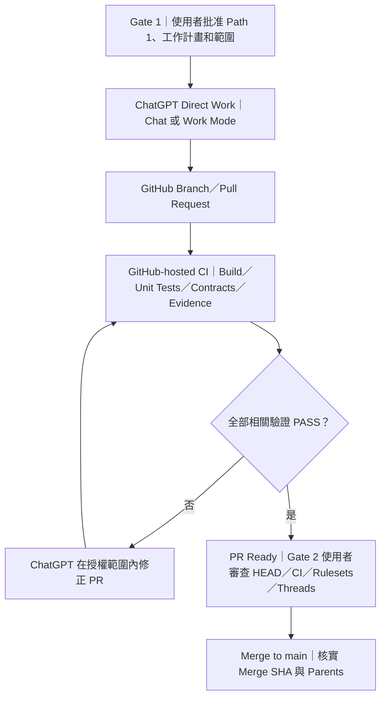
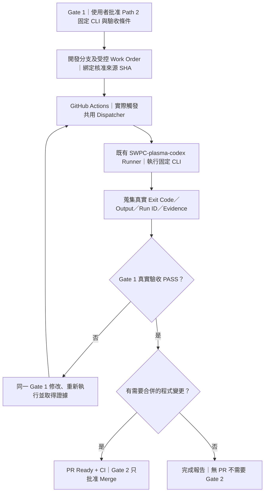
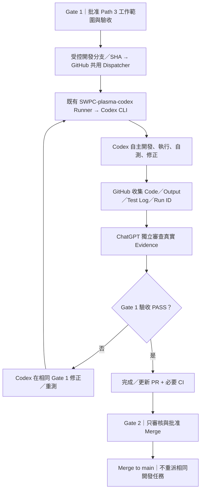

# PLASMA — Three-Path Work Execution Model（三路徑工作執行模型）

> **狀態：PLASMA Development Mode 三路徑規範；正式治理條款同步定義於根目錄 AGENTS.md。**
>
> **範圍：開發、CI、SWPC 工程工作調度，不是產品 PPU 的八 Site 燒錄排程器。**
>
> **注意：這份文件定義路徑與授權，不代表已部署通用 Dispatcher、觸發任何 Codex Job 或完成硬體驗收。**

本文件與根目錄 [AGENTS.md](../../AGENTS.md) §11.1～11.1B 同步。執行能力和目前已實作的 Workflow 以實際 repository／GitHub runner 狀態為準，不得把架構提議當作實機執行成果。

## 一、第一性原理：用執行邊界，而不是 UI 介面分類

- **ChatGPT Chat** 與 **ChatGPT Work Mode** 都可作為三條 Path 的互動入口；「Work」的工作能力不等同於必須打開「Work Mode」。
- **GitHub Actions** 是 Trigger／受控執行與驗證平台，GitHub-hosted 與 SWPC self-hosted Runner 是不同信任／存取邊界。
- **CLI 與 Codex 不同**：CLI 執行事先固定的指令；Codex 在核准的工作契約內自主修改、測試、迭代。不能把 Codex 存在視為可以任意存取硬體。
- **CI 不等於 CD**：合併 PR 不自動授權部署、重啟、改 FPGA、DUT 電源或燒錄 IC。部署、Runtime 和硬體行為必須明列 Gate 1 授權範圍。
- **Gate 1 選 Path 是授權與執行計畫的一部分**，不是第三個 Gate。
- **Gate 1 必須完成已授權的開發與真實驗收**：Path 2/3 若要求 SWPC 實測，應在合併前取得 Runner 執行證據並由 ChatGPT 判定；失敗在原 Gate 1 內修正、重測。
- **Gate 2 只批准特定 PR Merge**：不得為了讓 main-only Dispatcher 能執行，先合併尚未完成真實驗收的開發內容。Post-merge release/deployment 的獨立操作按原 Gate 1 明示範圍處理，不取代開發階段 E2E。

## 二、Path 1 — ChatGPT Direct Work

**推薦場景：** 程式碼、文件、資料研究、OpenOCD catalog、Host-only Build／Unit Test／Contracts 等不需要 SWPC 真實環境的工作。

**執行者：** ChatGPT 透過可用的 repository 工作能力實作及管理 PR；GitHub-hosted Runner 執行適用 CI。不得因工作源於聊天而誤標為 SWPC 或 Work Mode 的遠端執行。

## 三、Path 2 — SWPC CLI Work

**推薦場景：** 需要 SWPC 環境／測試設備，而固定 Bash／Python／Linux 工具即可完成的可重現工程工作，例如特定編譯、現場唯讀盤點、受控 HIL 或測試資料收集。

**執行者：** SWPC Runner 執行已審查的固定 CLI 命令；不是讓 Codex 推理與改碼。CLI 任務不可偷偷轉為 Path 3。沒有符合 Gate 1 條件的已啟用 Trigger／Runner 時，必須回報 `NOT_RUN` 和具體阻礙，不能把批准訊息當作 GitHub Job 已經啟動。

## 四、Path 3 — SWPC Codex Work

**推薦場景：** 必須使用 SWPC 及 Codex 的自主迭代能力，例如多模組問題定位、修復與反覆測試、真實軟硬體整合開發。

**執行者：** 既有 SWPC `SWPC-plasma-codex` Runner 與 Codex CLI；GitHub Actions 負責派工與收集 Code／Output／Log，Codex 負責自行開發、自行執行、自行測試與修正，**ChatGPT 審閱真實證據並判定 PASS/FAIL**。不要讓 SWPC Dispatcher 額外實作一個驗證 Codex 寫法的 AST/特定輸出格式檢查器。Job `SUCCESS`、Codex 自稱 `PASS`、有 Artifact，均不能直接代替獨立驗收。已知限制：

1. **批准 Gate 1 ≠ GitHub Workflow 自動發生。** ChatGPT／授權工具必須確實呼叫可用 Trigger，並以 GitHub Job 證據核對是否執行。若無法觸發，報告 `NOT_RUN`；不要求已批准事項再重複授權。
2. 現在已有共用 `plasma-engineering-runtime-dispatch.yml` 的 **Development Mode owner-only Issue #981 入口**，Path 2/3 均曾成功在既有 SWPC Runner 執行。然而這個入口**只從 main 讀取任務及 SHA**，尚不具備受控的 Gate 1 開發分支／PR Commit 派工能力。正式 qualification `workflow_dispatch` Runtime 仍停用。政策改成「先測、後 Merge」**不表示**技術入口已同步完成；下一項需要的任務應先修正此限制，或誠實回報 `NOT_RUN`，不得拿 Gate 2 合併來解鎖測試。
3. Codex 建 PR 時，若使用預設 `GITHUB_TOKEN`，**通常不會觸發新的 `pull_request` workflows**。須確保使用核准的 GitHub App token 或其他受控事件機制，讓必要 CI 真正開始。PR 建立成功不能代替 CI PASS。
4. SWPC Codex 帳號可能已有部分硬體存取權；「軟體專用 Prompt」不是 OS 層隔離。Z2／USB／LA／Power／FPGA／DUT 必須依 Gate 1 和安全契約明確允許才操作。
5. **Gate 1 完成 Path 3 真實 E2E 與證據審查，Gate 2 僅批准 Merge**。合併後的 `main` push 可啟動一般 CI，但**不能重新派發同一項 Codex 開發任務**。

## 五、Gate 1 — 推薦與選擇矩陣

| 問題 | Path 1 | Path 2 | Path 3 |
| --- | --- | --- | --- |
| Chat／Work Mode 都能作為入口？ | 是 | 是 | 是 |
| 主要實際執行者 | ChatGPT＋GitHub-hosted CI | SWPC 固定 CLI | SWPC Codex CLI |
| 需要 SWPC？ | 否 | 是 | 是 |
| 需要 Codex 進行自主迭代？ | 否 | 否 | 是 |
| 需要 PR？ | 程式變更時 | 有程式變更時 | 一般需要 |
| 需要硬體？ | 不會接觸本機硬體 | 視 Gate 1 範圍 | 視 Gate 1 範圍 |
| 優先選用條件 | Host-only 已足夠 | 必須 SWPC，固定命令足夠 | 必須 SWPC，且需 Agent 自主性 |
| 成功證據 | Hosted CI／PR | SWPC CLI 真實執行輸出＋ChatGPT 審閱 | Codex Code／Output／Test Log＋ChatGPT 獨立審閱；需要 PR 時再加 CI |

**Path 的最佳化目標：以最少資源、最小實際權限與最短迴圈，取得能回答工程假設的證據。** 刻意避免把同一個 ARMv7 QEMU 函式測試搬到另一台主機重跑，卻沒有額外測試假設。

### 未來每次 Gate 1 的建議模板

> **工作：** 具體目標與第一個可測量 PASS／FAIL
>
> **推薦：** Path N — 一句話說明為何是最低足夠成本與權限
>
> **實際路徑：** ChatGPT 入口 → GitHub Dispatch／PR → Runner／Executor → Evidence
>
> **變更：** 檔案／環境／使用資源／已核准軟硬體動作
>
> **驗收：** 指定 CI／HIL／Hash／Artifact／清理與恢復條件
>
> **不允許：** 超出 Gate 1 的存取、部署及其他 PR Merge
>
> **按鈕：** 「批准 Gate 1 — Path 1」、「批准 Gate 1 — Path 2」、「批准 Gate 1 — Path 3」；如有必要第 4 顆按鈕「暫緩／修改」。不可執行的路徑需明顯註記，不得提供看似有效的批准。
>
> **批准後：** 自主執行、建立／更新 PR、修正 CI、完成證據、停在 Gate 2；遇阻礙才報告。

建議 Path 必須說明理由，不能強制使用者選擇；使用者普通文字明確選 Path／批准同樣有效。單純點選預設值或看見按鈕並不構成授權。對話介面不能顯示按鈕時，提供最多四個簡短文字選項，不得假裝按鈕存在。

## 六、Gate 1／Gate 2 的職責，及少數無 PR 任務

| 項目 | Gate 1 — Plan Approval | Gate 2 — Merge Approval |
| --- | --- | --- |
| 使用者決策 | 指定工作計畫、Path、許可範圍 | 指定 PR、HEAD 和合併方法 |
| 開發／測試／Codex | 已授權即執行真實環境測試、取得證據、FAIL 則修正重測直到符合驗收，或誠實回報阻礙 | 不啟動同一開發任務、不用 Merge 解鎖缺少的測試 |
| CI／Evidence | 實際觸發、修正、採集、核對 | 檢查現有的 CI、Evidence |
| Merge | 不允許 | 即時核對後才允許 |
| 實體 Z2／LA／DUT／部署 | 必須明確列入 Gate 1 才可操作 | 不因合併而擴權 |
| 範圍有重大變更 | 停止並提出修訂 Gate 1 | 不以 Gate 2 掩蓋超範圍 |

**開發階段強制順序：Gate 1 = Build → Real Run → Evidence Review → Fix/Retest → PR/CI Ready；Gate 2 = Merge Decision。**

目前 GitHub `issue_comment` 的 owner-only Development Mode 入口仍要求 `main`，不支援讓 PR 分支程式直接實測。更新本文件**不會自行解除這個技術限制**；遇到此阻礙應在 Gate 1 先完成最小 Dispatcher 改進的獨立驗證，或清楚回報 `NOT_RUN`，不可為此提前 Merge。

**Gate 1 已批准後即可執行**，不額外要求每次 SSH、測試、建立 PR、Draft → Ready 的核准；但工具不通、硬體安全事實不符或需新權限時必須安全停止並回報。經核准而可以到達的 Gate 2，只授權合併該特定 PR。

純唯讀檢測、已有工具的受控測試或產生 Evidence 且不建立／合併 PR 的任務，Gate 1 後完成證據回報即可。**不要為沒有 PR 的任務創造「假 Gate 2」。**

## 七、實證邊界與任務結束報告

每一 Path 完成時必須回報：使用者批准的 Path、真正執行的環境、GitHub Run ID／PR HEAD、測試 PASS／FAIL／NOT_RUN、Artifact 或 SHA256、阻礙、M1 狀態與下一個必要決策。

- GitHub-hosted CI PASS **不是** SWPC CLI PASS。
- SWPC QEMU PASS **不是** 真實 Z2 ARM Cortex-A9 PASS。
- CPU Native 執行 PASS **不是** PS7→AXI→PL 實際順序保證。
- Mock／OpenOCD route candidate／設備型錄 admission **不是** 真實 IC 燒錄驗收。

**本治理文件只記錄執行模式。** 不部署 Dispatcher、不啟用 self-hosted workflows、不操作 SWPC、Codex、Z2、FPGA、LA 或 DUT，也不更動產品 runtime。
