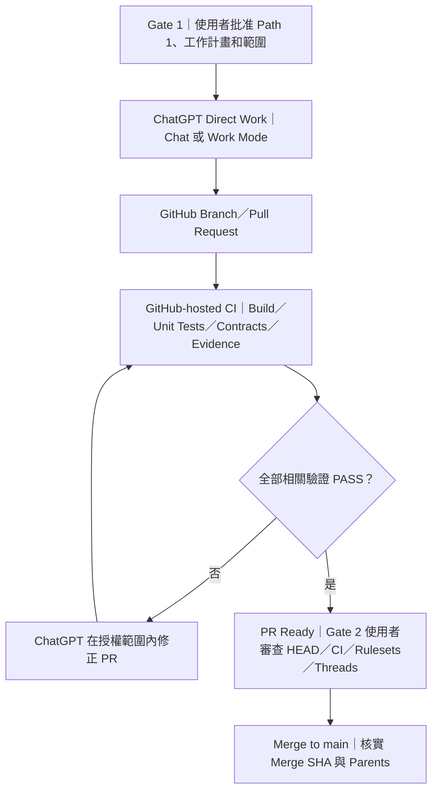
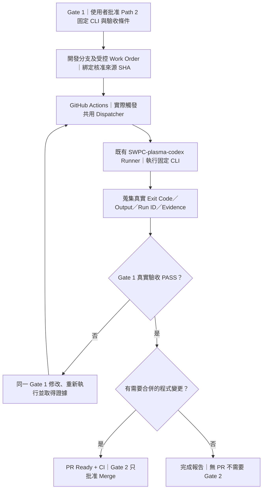
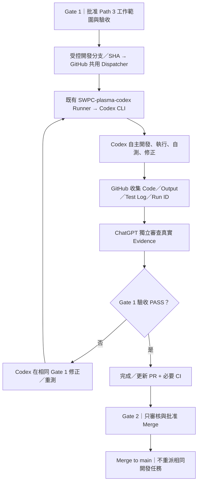

# PLASMA — Three-Path Work Execution Model（三路徑工作執行模型）

> **狀態：PLASMA Development Mode 三路徑規範；正式治理條款同步定義於根目錄 AGENTS.md。**
>
> **範圍：開發、CI、SWPC 工程工作調度，不是產品 PPU 的八 Site 燒錄排程器。**
>
> **注意：Path 3 的既有 Development Mode owner-only Dispatcher 已完成指定的軟體驗收（見下方紀錄）；這不代表通用 Qualification Dispatcher 已啟用，或已完成任何實體硬體驗收。**

本文件與根目錄 [AGENTS.md](../../AGENTS.md) §11.1～11.1B 同步。執行能力和目前已實作的 Workflow 以實際 repository／GitHub runner 狀態為準，不得把架構提議當作實機執行成果。

## Path 3 Core Development Workflow — Completion Record (2026-10-21)

| 欄位 | 正式紀錄 |
| --- | --- |
| 工作項目 | Path 3 Core Development Workflow（SWPC Codex Work） |
| 狀態 | **COMPLETED — Development Mode core software workflow** |
| 完成日期 | 2026-10-21（Asia/Taipei） |
| 對應 PR | [#1083 — Development Mode gating simplification](https://github.com/physicslu/plasma/pull/1083)，已合併 |
| Merge SHA | `51a42c1314de8e2164dcfe0f106160bf301be13c` |
| Merge Parents | `50f80b96d8947f00df05fd6efc31107728c3d2d0`（main）；`d5c230fd3e6bf57d0069b5a85a72fad4a2b9ea6c`（PR HEAD） |
| 實測執行 | [Issue #981 Post-merge Run #39544912173](https://github.com/physicslu/plasma/actions/runs/39544912173)：`development-authorize` SUCCESS、`development-codex` SUCCESS；SWPC `SWPC-plasma-codex` Runner；真實 Codex exit 0 |
| 驗收證據 | [Artifact #12320947537](https://github.com/physicslu/plasma/actions/runs/39544912173/artifacts/12320947537)；ZIP SHA256 `1a4ba800c824b3af0cb7760e2a079995601a54daf4c28378507eb66c4b14075d`；已記錄 12/12 三角數獨立驗證及內部 manifest 10/10 項一致 |
| Gating 結論 | Gate 1 執行／證據與 PR #1083 Gate 2 合併已完成；後續工作仍個別遵守 Gate 1／Gate 2 授權，不因本完成標記自動獲得 SWPC 或硬體操作許可 |

**完成範圍：** 既有 owner-only Issue #981 → trusted `main` Dispatcher → SWPC `development-codex` → 真實 Codex CLI 的 Development Mode 軟體派工、工作來源／Runner／Registry Admission、完成或失敗 Receipt、證據保留及獨立驗收流程。Path 3 可在適用的已授權任務契約與目前已實作的 Trigger 下使用；本紀錄不是對任意工作自動派工的授權。

**明確保留的例外與未完成範圍：**

- PR #1083 **合併前 Candidate Dispatcher + real Codex 完整 E2E = NOT_RUN**，為 Owner 明確接受的 Gate 2 例外；合併後新 `main` Dispatcher + real Codex 軟體 E2E = PASS。兩者不得混稱。
- 此 CPU-only Smoke **不證明**通用 RTL/Vivado 多模組開發、Z2／PS→PL／FPGA Manager／SWD／DUT 實體 HIL，亦不證明完整 OS 級硬體隔離。需依每項已批准 Gate 1 的實際操作與證據個別驗收。
- 通用 Qualification `workflow_dispatch` Runtime 未因本紀錄啟用；不得宣稱 Production Ready，也不變更 Runner、權限、憑證、部署或硬體狀態。
- 遵守 Development Mode **兩個人工 Gate**：Gate 1（Plan/Path/Scope/Acceptance）、Gate 2（僅在 PR 需要 Merge 時）。Worker Admission、CI、Evidence Review 不是額外人工 Gate。

## 一、第一性原理：用執行邊界，而不是 UI 介面分類

- **ChatGPT Chat** 與 **ChatGPT Work Mode** 都可作為三條 Path 的互動入口；「Work」的工作能力不等同於必須打開「Work Mode」。
- **GitHub Actions** 是 Trigger／受控執行與驗證平台，GitHub-hosted 與 SWPC self-hosted Runner 是不同信任／存取邊界。
- **CLI 與 Codex 不同**：CLI 執行事先固定的指令；Codex 在核准的工作契約內自主修改、測試、迭代。不能把 Codex 存在視為可以任意存取硬體。
- **CI 不等於 CD**：合併 PR 不自動授權部署、重啟、改 FPGA、DUT 電源或燒錄 IC。部署、Runtime 和硬體行為必須明列 Gate 1 授權範圍。
- **Gate 1 選 Path 是授權與執行計畫的一部分**，不是第三個 Gate。
- **Gate 1 必須完成已授權的開發與真實驗收**：Path 2/3 若要求 SWPC 實測，應在合併前取得 Runner 執行證據並由 ChatGPT 判定；失敗在原 Gate 1 內修正、重測。
- **Owner 批准新增機制**：優先沿用已驗證的建置腳本、Board Files 準備、Dispatcher、Runner 及 Artifact 檢查。既有 Gate 1 內的缺陷修復與重測不需重複批准；但若需要新腳本、Workflow、Runner、驗證架構、隔離平台或新增獨立機制，先提出證據、既有方案不可重用的原因、最小修改範圍與影響，取得 Owner 明確同意再實作。不得將額外設計工作偽裝成已核准的例行修補。
- **Evidence Reuse / Execute-first**：已有同一工具鏈、板卡版號、Runner 與適用契約的真實有效證據時，不再新增第二套 preflight、Workflow、Runner 或重複要求 Owner 批准；已批准的任務應直接執行既有受控 Path，失敗才依 Exit Code／實際 Receipt 在同一 Gate 1 修補。仍保留當次執行所必須的身分、SHA、權限、硬體隔離及範圍保護，不得因省略重複確認而繞過安全控制；缺少執行證據須標示 NOT_RUN。
- **Gate 2 只批准特定 PR Merge**：不得為了讓 main-only Dispatcher 能執行，先合併尚未完成真實驗收的開發內容。Post-merge release/deployment 的獨立操作按原 Gate 1 明示範圍處理，不取代開發階段 E2E。

## 二、Path 1 — ChatGPT Direct Work

**推薦場景：** 程式碼、文件、資料研究、OpenOCD catalog、Host-only Build／Unit Test／Contracts 等不需要 SWPC 真實環境的工作。

**執行者：** ChatGPT 透過可用的 repository 工作能力實作及管理 PR；GitHub-hosted Runner 執行適用 CI。不得因工作源於聊天而誤標為 SWPC 或 Work Mode 的遠端執行。

## 三、Path 2 — SWPC CLI Work

**推薦場景：** 需要 SWPC 環境／測試設備，而固定 Bash／Python／Linux 工具即可完成的可重現工程工作，例如特定編譯、現場唯讀盤點、受控 HIL 或測試資料收集。

**執行者：** SWPC Runner 執行已審查的固定 CLI 命令；不是讓 Codex 推理與改碼。CLI 任務不可偷偷轉為 Path 3。沒有符合 Gate 1 條件的已啟用 Trigger／Runner 時，必須回報 `NOT_RUN` 和具體阻礙，不能把批准訊息當作 GitHub Job 已經啟動。

**Development Mode Z2 SSH／sudo 單一憑證原則：** Path 2 與 Path 3 均使用同一 `plasma-codex` 帳號的 `~/.config/plasma/z2-login-smoke.json`，含 `ssh_host`、`ssh_username`、`ssh_password`，以及僅在 sudo 密碼不同時需要的 `sudo_password`。不得讀取或回退至歷史 `z2-dev-credentials.json`；舊的 SWD-05 專用 Route 檔已不屬於 Path 2／3 SSH 憑證契約；兩條 Path 都不得依賴它。`z2-login-known_hosts` 是供兩條 Path 共用的公開 Host Key Pin，**不是第二份憑證**，仍必須保留。舊有憑證須在比對 Host/身分與 sudo 密碼、完成單一憑證及路徑配置寫入／讀回確認後，才由 SWPC worker 本機安全刪除，衝突則停止。此簡化不移除真實 SSH／sudo 驗證、Trusted Main Dispatcher、Root Entry、來源 SHA、B1/B2/B3 與 Restore 保護。

## 四、Path 3 — SWPC Codex Work

**推薦場景：** 必須使用 SWPC 及 Codex 的自主迭代能力，例如多模組問題定位、修復與反覆測試、真實軟硬體整合開發。

**Development Mode 實作修訂（2026-10-20；依已合併 PR #1108 更新）：** Path 3 是 Codex 自主工程執行模式，不再以單一 generated Python／CSV 作為唯一工作成果。Codex 可在已授權的候選工作樹內修改 RTL、Tcl、Python、測試和文件，並在適用的核准範圍內執行 Vivado 2026.1 Synthesis、Implementation、Timing、DRC 和 BIT／HWH 建置，記錄實際錯誤、根因／假設、修正、重測以及 SHA256。原有 480 秒 Codex 子程序上限已移除；Workflow 原 12 分鐘上限改為 360 分鐘的外部故障保護，而非要求設計在數分鐘內完成。既有 Candidate 檔案白名單拒絕改碼的檢查已移除，改保存完整 Git diff、未追蹤來源檔與工程報告，由 Reviewer 判讀真實證據。Host-only Vivado Build 只證明主機端建置，不構成 FPGA 載入或其他實體操作的授權。

**Path 3 不預設 Host-only，也不強制人工分流。** 通用 Path 3 Work Order 不要求 `scope: host-only`／`scope: guarded-hardware`、預先列出 `hardware_stages` 或將同一工程目標拆成多個人工批准的 Work Order。Codex 在既有 Gate 1 範圍內自主選擇開發、建置與測試步驟；任何涉及 Z2／FPGA Manager／MMIO／SWD／USB／LA／DUT／Power 的實體效果，仍須在 Owner 核准範圍內，通過 B1（授權及來源）、B2（當前硬體安全與復原）、B3（真實結果與失敗停止），並由既有可信 Stage Transport／受保護 Root Executor 執行。Work Order 文字或 Codex Prompt 不會授予 sudo、SSH 或裝置存取權；若現有執行入口無法安全完成所要求的硬體委派，須明確回報 `NOT_RUN`／具體阻礙，不得繞過 Sandbox 或聲稱實體驗收 PASS。現有 Path 3 的普通 SWPC USB／TTY 開發工具可在 Owner Gate 1 授權下直接使用，透過非 Root Bubblewrap 執行環境提供 `/dev/bus/usb`、目前 `/dev/ttyACM*` 與 `/dev/ttyUSB*` 的可見性，不需要新模式、新 Lab Session、新 DUT 專用 Stage 或新 Work Order 欄位。Linux DAC／ACL 仍決定能否實際開啟設備。現有受保護 Z2 Root Stage 的通用動態委派尚未實作，禁止把 USB 可見性視為特權操作已授權。開發實驗遵循「一次完整有效 PASS 即停止」；FAIL／證據不足才有理由針對性重測，Program／Readback／Verify 不設額度。

**執行者：** 既有 SWPC `SWPC-plasma-codex` Runner 與 Codex CLI；GitHub Actions 負責派工與收集 Code／Output／Log，Codex 負責自行開發、自行執行、自行測試與修正，**ChatGPT 審閱真實證據並判定 PASS/FAIL**。不要讓 SWPC Dispatcher 額外實作一個驗證 Codex 寫法的 AST/特定輸出格式檢查器。Job `SUCCESS`、Codex 自稱 `PASS`、有 Artifact，均不能直接代替獨立驗收。已知限制：

1. **批准 Gate 1 ≠ GitHub Workflow 自動發生。** ChatGPT／授權工具必須確實呼叫可用 Trigger，並以 GitHub Job 證據核對是否執行。若無法觸發，報告 `NOT_RUN`；不要求已批准事項再重複授權。
2. 現有共用 `plasma-engineering-runtime-dispatch.yml` 提供 **Development Mode owner-only Issue #981 入口**。可信 Dispatcher 仍來自 `main`，但已支援在 Owner 核准後讀取同儲存庫未合併 PR 的精確 HEAD SHA 與候選任務 Registry／工作樹；該路徑適用 Path 2/3。新的 Path 3 開發契約仍須先合併到 `main` 的可信 Dispatcher 後，才可能在既有 Runner 生效。正式 qualification `workflow_dispatch` Runtime 仍停用。
3. Codex 建 PR 時，若使用預設 `GITHUB_TOKEN`，**通常不會觸發新的 `pull_request` workflows**。須確保使用核准的 GitHub App token 或其他受控事件機制，讓必要 CI 真正開始。PR 建立成功不能代替 CI PASS。
4. SWPC Codex 帳號可能已有部分硬體存取權；「軟體專用 Prompt」不是 OS 層隔離。Z2／USB／LA／Power／FPGA／DUT 必須依 Gate 1 和安全契約明確允許才操作。
5. **Gate 1 完成 Path 3 真實 E2E 與證據審查，Gate 2 僅批准 Merge**。合併後的 `main` push 可啟動一般 CI，但**不能重新派發同一項 Codex 開發任務**。

### Path 3 Admission 與失敗證據最小化（Gate 1 Draft）

**安全檢查數量不等於人工 Gate 數量。** 使用者 Gate 1 一次授權
Codex 在既定工作樹／Objective 內自主進行 Code → Test → Fix → Retest，
不需要因可恢復的軟體編譯失敗再向使用者取得批准；超出工作範圍、
權限不足、實體 FPGA／AXI 安全不明及失敗恢復 UNKNOWN，仍必須立即停止。

- **GitHub-hosted Admission**：確認 Owner、Issue #981、PR 與可信 main SHA、
  Candidate 精確 Commit SHA、Task Registry SHA256 及合法 Path。
- **SWPC Worker Admission**：重用同一個 Python `worker_admission()` 函式
  進行第二信任邊界的獨立 SHA/Registry/Runner/Path 檢查，統一回報
  `WORKER_SOURCE_ADMITTED`；不得省略第二次校驗或將它當成另一道人工 Gate。
- **Codex 自主工程迴圈**：單一 Codex CLI 程序在同一 Job 內自行診斷、
  修改及重跑允許的測試；Dispatcher 不新增 Agent Retry Supervisor，
  不另起 SWPC Job，不因 Exit Code 自動重派硬體指令。
- **失敗證據與退出碼**：`run_codex_task()` 即使 Codex 非零退出，也產生
  `CODEX_EXECUTION_FAILED_REVIEW_REQUIRED` Receipt，保留實際 Exit Code
  與 Codex Session Log；若 Exit Code 0 但沒有可用的工程報告或完整舊版
  Source/Output/Test Log，則為 `CODEX_EVIDENCE_INCOMPLETE_REVIEW_REQUIRED`。
  兩者 Workflow 仍 **FAIL（非零退出）**，不能視為工程 PASS。
- **失敗後收集**：共用 Workflow 以 `if: always()` 執行獨立的證據收集步驟，
  保存含已暫存／未暫存變更的 `git diff HEAD --binary`、未追蹤檔清單／
  壓縮檔、工程報告、Codex 日誌、Artifact Hash；不因 `set -e`
  造成初始工作失敗時跳過所有證據。Runner 異常中斷、磁碟／網路故障、
  Job 硬超時仍可能讓資料採集不完整，不能宣稱絕對保證。

本 Draft PR 僅執行 GitHub-hosted 離線負向與回歸測試，**不發出 Issue #981 指令**，
不啟動 SWPC self-hosted、Codex CLI、Vivado 或 Z2；沒有實機權限、
部署或 PR Merge 授權。離線 CI PASS 不等於真正 SWPC Path 3 E2E PASS。

### Candidate Dispatcher 合併前測試入口（PR #1083）

若 PR 修改的是 `scripts/plasma_development_dispatch.py` **本身**，Issue #981
正式 `issue_comment` 入口仍必須執行可信 `main` Dispatcher，不得透過
`--pr/--sha` 偷換授權程式。既有 `pull_request` 已提供 Branch 測試入口；
在**同一份共用 Workflow** 內增加 `candidate-dispatcher-premerge` GitHub-hosted
Job，分別 Checkout 精確 Base SHA 與 Candidate HEAD SHA，驗證 Git Tree
後執行候選 Dispatcher 的**真實命令列程式**與完全模擬的 Owner Event／PR
Metadata／Codex Stub：

- 正例：`authorize` 與 `execute-codex` CLI 依序通過，檢查三種 SHA
  傳遞、12 筆三角數、Exit Code 與 Receipt。
- 負例：模擬 Codex 非零退出須令 Dispatcher 非零退出且保留失敗證據；
  Registry SHA、Candidate SHA 或 Owner 不符須拒絕，且在啟動 Stub 前停止。
- 無 SWPC/self-hosted Runner，無真 Codex、Vivado、硬體／USB／MMIO。
  Stub 暫時設定的 Runner 環境變數**僅是 GH-hosted 內的測試資料**，
  結果必須標示 `HOSTED_SIMULATION_ONLY`，不可宣稱 SWPC E2E PASS。
- 測試 Job 使用 GitHub-hosted ephemeral Runner、唯讀 repo token、不
  持久化 Git credentials；不新增第二份 Workflow／Runner／Dispatcher，
  不呼叫 Issue #981，亦不影響其他 Path 的正式派工模式。

這條入口能在 Merge 前驗證 **Candidate Dispatcher CLI 控制流程**，
但無法驗證 SWPC 上的真實 OS 身分、實際權限隔離與 Codex 行為。
若要在合併前於 **SWPC 真正執行 Candidate Dispatcher**，仍須有可信
主控建立的 OS 級純軟體 Sandbox（不接觸實體設備）並能由獨立證據
證明隔離，不能直接以 GitHub-hosted 假身分或 Prompt 取代。
未建立這一條安全邊界前，SWPC Candidate E2E = `NOT_RUN`。

**合併前 SWPC 純軟體沙箱測試（候選實作）：**
不用授權候選 Dispatcher 作為控制平面。用已存在的可信 main Path 2
`cpu-only` 派工，限定新登錄的
`candidate-dispatcher-premerge-sandbox` 任務，從精確 PR SHA Checkout
候選工作樹，交由可信 `run_task(...,sandbox=True)` 啟動已存在的
`bubblewrap` 隔離：唯讀 `/work`、合成 `/dev`、隔離全部 namespaces
（含 network）、`--clearenv`、`-I -S` Python、40 秒時限。
沙箱內只執行 Candidate Dispatcher 的模擬 Owner/Runner CLI 與
Stub Codex，輸出固定 `CANDIDATE_DISPATCHER_PREMERGE_SWPC_BWRAP_STUB_PASS`
並由可信 Dispatcher 驗證 SHA256。若 bwrap 缺少、不支援 userns
或隔離條件不成立則 Fail Closed，不得降級為裸執行。這條路徑
實際執行 Candidate Dispatcher 程式碼，但**不啟動真 Codex、不核可
SWPC 硬體權限，也不代表完整 Path 3 Agent E2E**。

## 五、Gate 1 — 推薦與選擇矩陣

| 問題 | Path 1 | Path 2 | Path 3 |
| --- | --- | --- | --- |
| Chat／Work Mode 都能作為入口？ | 是 | 是 | 是 |
| 主要實際執行者 | ChatGPT＋GitHub-hosted CI | SWPC 固定 CLI | SWPC Codex CLI |
| 需要 SWPC？ | 否 | 是 | 是 |
| 需要 Codex 進行自主迭代？ | 否 | 否 | 是 |
| 需要 PR？ | 程式變更時 | 有程式變更時 | 一般需要 |
| 需要硬體？ | 不會接觸本機硬體 | 視 Gate 1 範圍 | 視 Gate 1 範圍 |
| 優先選用條件 | Host-only 已足夠 | 必須 SWPC，固定命令足夠 | 必須 SWPC，且需 Agent 自主性 |
| 成功證據 | Hosted CI／PR | SWPC CLI 真實執行輸出＋ChatGPT 審閱 | Codex Code／Output／Test Log＋ChatGPT 獨立審閱；需要 PR 時再加 CI |

**Path 的最佳化目標：以最少資源、最小實際權限與最短迴圈，取得能回答工程假設的證據。** 刻意避免把同一個 ARMv7 QEMU 函式測試搬到另一台主機重跑，卻沒有額外測試假設。

### 未來每次 Gate 1 的建議模板

> **工作：** 具體目標與第一個可測量 PASS／FAIL
>
> **推薦：** Path N — 一句話說明為何是最低足夠成本與權限
>
> **實際路徑：** ChatGPT 入口 → GitHub Dispatch／PR → Runner／Executor → Evidence
>
> **變更：** 檔案／環境／使用資源／已核准軟硬體動作
>
> **驗收：** 指定 CI／HIL／Hash／Artifact／清理與恢復條件
>
> **不允許：** 超出 Gate 1 的存取、部署及其他 PR Merge
>
> **按鈕：** 「批准 Gate 1 — Path 1」、「批准 Gate 1 — Path 2」、「批准 Gate 1 — Path 3」；如有必要第 4 顆按鈕「暫緩／修改」。不可執行的路徑需明顯註記，不得提供看似有效的批准。
>
> **批准後：** 自主執行、建立／更新 PR、修正 CI、完成證據、停在 Gate 2；遇阻礙才報告。

建議 Path 必須說明理由，不能強制使用者選擇；使用者普通文字明確選 Path／批准同樣有效。單純點選預設值或看見按鈕並不構成授權。對話介面不能顯示按鈕時，提供最多四個簡短文字選項，不得假裝按鈕存在。

## 六、Gate 1／Gate 2 的職責，及少數無 PR 任務

| 項目 | Gate 1 — Plan Approval | Gate 2 — Merge Approval |
| --- | --- | --- |
| 使用者決策 | 指定工作計畫、Path、許可範圍 | 指定 PR、HEAD 和合併方法 |
| 開發／測試／Codex | 已授權即執行真實環境測試、取得證據、FAIL 則修正重測直到符合驗收，或誠實回報阻礙 | 不啟動同一開發任務、不用 Merge 解鎖缺少的測試 |
| CI／Evidence | 實際觸發、修正、採集、核對 | 檢查現有的 CI、Evidence |
| Merge | 不允許 | 即時核對後才允許 |
| 實體 Z2／LA／DUT／部署 | 必須明確列入 Gate 1 才可操作 | 不因合併而擴權 |
| 範圍有重大變更 | 停止並提出修訂 Gate 1 | 不以 Gate 2 掩蓋超範圍 |

**開發階段強制順序：Gate 1 = Build → Real Run → Evidence Review → Fix/Retest → PR/CI Ready；Gate 2 = Merge Decision。**

目前 GitHub `issue_comment` 的 owner-only Development Mode 入口使用 `main` 的可信 Dispatcher 驗證 Owner、PR HEAD SHA 與指定執行能力，候選工程內容可來自未合併 PR；**文件變更不代表 Runner 已載入新版 Dispatcher**。只有相應 Workflow／Dispatcher 真正合併至 `main` 並實際執行後，才能回報新能力已生效。

**Gate 1 已批准後即可執行**，不額外要求每次 SSH、測試、建立 PR、Draft → Ready 的核准；但工具不通、硬體安全事實不符或需新權限時必須安全停止並回報。經核准而可以到達的 Gate 2，只授權合併該特定 PR。

純唯讀檢測、已有工具的受控測試或產生 Evidence 且不建立／合併 PR 的任務，Gate 1 後完成證據回報即可。**不要為沒有 PR 的任務創造「假 Gate 2」。**

## 七、實證邊界與任務結束報告

每一 Path 完成時必須回報：使用者批准的 Path、真正執行的環境、GitHub Run ID／PR HEAD、測試 PASS／FAIL／NOT_RUN、Artifact 或 SHA256、阻礙、M1 狀態與下一個必要決策。

- GitHub-hosted CI PASS **不是** SWPC CLI PASS。
- SWPC QEMU PASS **不是** 真實 Z2 ARM Cortex-A9 PASS。
- CPU Native 執行 PASS **不是** PS7→AXI→PL 實際順序保證。
- Mock／OpenOCD route candidate／設備型錄 admission **不是** 真實 IC 燒錄驗收。

**本治理文件只記錄執行模式。** 不部署 Dispatcher、不啟用 self-hosted workflows、不操作 SWPC、Codex、Z2、FPGA、LA 或 DUT，也不更動產品 runtime。
